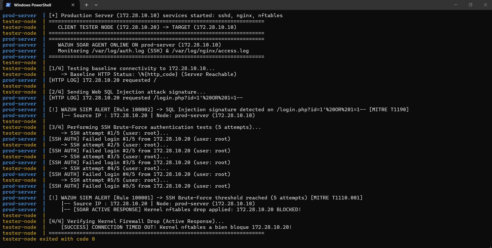
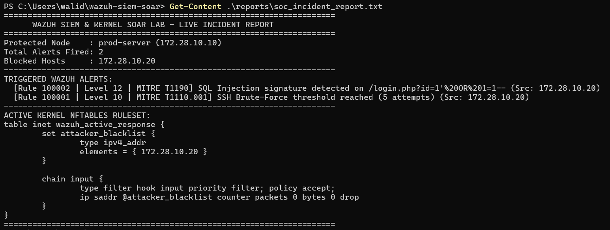

# Dockerized SIEM & Kernel SOAR Lab (Python + Linux `nftables`)

A reproducible 2-node **Docker Compose Cyber Range** (`172.28.10.0/24`) demonstrating real-time log telemetry parsing, **MITRE ATT&CK** threat detection (modeled on Wazuh XML rules), and automated **Linux kernel firewall remediation (`nftables`)**.

> **Engineering Progression Note:** This repository contains **Phase 1 (Lightweight Custom Python SOAR Daemon & Kernel `nftables` Active Response)** built from scratch to demonstrate low-level log correlation and Linux netfilter packet dropping. Phase 2 integrates the full enterprise **Wazuh Indexer, Manager, and Dashboard** stack.

---

## Cyber Range Network Architecture (`172.28.10.0/24`)

| Node | IPv4 Address | OS / Stack | Role |
| :--- | :---: | :--- | :--- |
| **`prod-server`** | `172.28.10.10` | Ubuntu 24.04 (`openssh-server`, `nginx`, `nftables`, Python 3) | Monitored production server running the real-time SOAR daemon with `CAP_NET_ADMIN` kernel privileges. |
| **`tester-node`** | `172.28.10.20` | Alpine Linux (`curl`, `openssh-client`, `sshpass`) | Automated security validation node executing baseline checks, SQLi probes, and SSH brute-force attempts. |

---

## Detection Logic & MITRE ATT&CK Mapping (`local_rules.xml`)

| Rule ID | Severity | Attack Vector | MITRE ATT&CK | Automated SOAR Response |
| :--- | :---: | :--- | :---: | :--- |
| **`100001`** | `Level 10` | **SSH Brute-Force** (5 failed logins from same IP) | `T1110.001` (Password Guessing) | Kernel `nftables` IP Blacklist (`DROP`) + JSON Alert |
| **`100002`** | `Level 12` | **SQL Injection (SQLi)** payload in HTTP URI | `T1190` (Exploit Public-Facing App) | Real-time SIEM Alert + Incident Report Logging |
| **`100003`** | `Level 12` | **Path Traversal / LFI** (`../../etc/passwd`) | `T1083` (File & Directory Discovery) | Kernel `nftables` IP Blacklist (`DROP`) + JSON Alert |

---

## Live Lab Execution & Kernel Verification

### 1. Real-Time Multi-Container Telemetry & Active Firewall Drop

### 2. Automated SOC Incident Report & Exported `nftables` Ruleset

---

## Quick Start (Reproduce in 1 Command)

    git clone https://github.com/walid-itrara/wazuh-siem-soar-lab.git
    cd wazuh-siem-soar-lab
    docker compose up --build

---

## Generated Forensics Artifacts (`/reports`)
- `reports/wazuh_alerts.json`: Structured JSON alerts mapped to MITRE ATT&CK.
- `reports/firewall_blocklist.nft`: Live dump of the Linux kernel `inet wazuh_active_response` table.
- `reports/soc_incident_report.txt`: Consolidated executive incident summary.